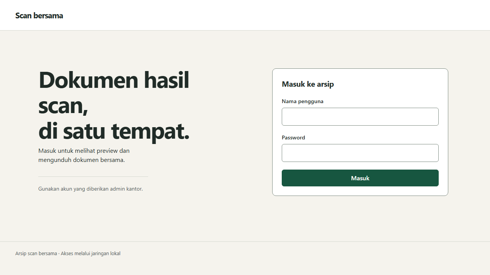
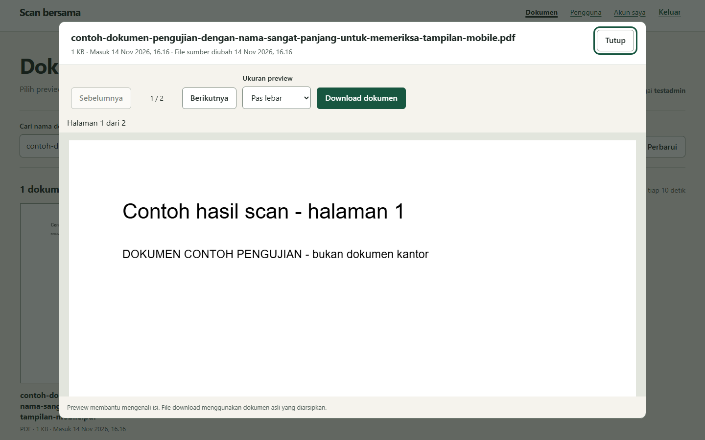

# Scan bersama

Web arsip hasil scan untuk jaringan kantor. Epson/aplikasi penerima menyimpan file ke folder masuk; aplikasi ini mengarsipkan file tersebut dan menampilkannya setelah pengguna login. Semua pengguna aktif dapat melihat dan mengunduh seluruh dokumen bersama.

Ditujukan untuk Windows Server 2022 dengan IIS. Web dapat dipakai tanpa internet setelah pemasangan dan pengunduhan dependensi selesai.

Konfigurasi pemasangan yang dipilih pemilik: **HTTP melalui IP server**, misalnya `http://192.168.1.10:8080`. IP pada panduan ini adalah contoh; ganti dengan IPv4 LAN server kamu. Tidak membutuhkan DNS atau sertifikat HTTPS.

## Fitur

- Login akun lokal dengan ASP.NET Core Identity, password di-hash, tanpa registrasi publik.
- Admin membuat pengguna/admin lain, mereset password, serta mengaktifkan/menonaktifkan akun.
- Perubahan password hanya oleh admin; pengguna biasa dapat login dan logout.
- Hapus dokumen dari preview khusus admin, dengan konfirmasi dan pemeriksaan izin pada server.
- Galeri thumbnail PDF/JPEG/PNG, pencarian nama, filter PDF/gambar, dan pagination 24 dokumen.
- Preview PDF per halaman, zoom/pas lebar, preview gambar, dan download file arsip.
- Pembaruan galeri setiap 2 detik saat tab aktif, tanpa membatalkan permintaan otomatis yang masih berjalan.
- Deteksi file yang stabil, batas ukuran, dan pemeriksaan penanda format sebelum impor.
- Dokumen disalin ke arsip terpisah; file masuk asli tidak dihapus atau diubah.
- Galeri dan endpoint file memerlukan login, termasuk permintaan rentang byte PDF.
- Semua aset PDF.js/font/WASM disajikan secara lokal, tanpa CDN.

Dokumen yang dihapus tidak dapat lagi diakses melalui web. File sumber di Documents/Incoming tetap disimpan; penanda penghapusan mencegah file dengan nama dan isi yang sama diimpor kembali.

<details>
<summary>Contoh tampilan</summary>

Cuplikan berikut memakai akun dan dokumen **contoh pengujian**, bukan data kantor.




</details>

## Alur dan batasan printer

```text
L6260 -> aplikasi penerima scan -> Incoming
                                  |
                           importer aplikasi
                                  |
                            arsip di Data
                                  |
                       web login + preview
                                  |
                         browser pengguna
```

**Aplikasi ini mengelola file hasil scan, bukan driver scanner atau pengganti protokol Epson Cloud.** Menjalankan web tidak otomatis membuat server muncul pada menu Scan > Computer di printer.

Penerimaan scan dari panel L6260 ke Windows Server 2022 sudah berhasil diuji di lokasi dengan Epson Scan 2, Epson Event Manager 3.11.82, dan ScanSmart 3.7.20. Panduan L6260 menjelaskan ScanSmart untuk scan dari panel pada Windows modern. Hasil pengujian ini berlaku pada server yang diuji; perilaku setelah desktop terkunci, logout, dan reboot belum diverifikasi.

- [Panduan L6260: scan dari panel](https://download4.epson.biz/sec_pubs/l6260_series/useg/en/GUID-729B4AC0-133D-4722-9103-427E5C3E984D.htm)
- [Driver dan aplikasi resmi L6260](https://www.epson.co.id/Printer-InkTank/L-Series/Epson-L6260/s/SPT_C11CJ62502)

Jika penerimaan dari panel belum berfungsi, web tetap dapat diuji dengan PDF yang disimpan dari Epson Scan 2. Alternatif arsitektur adalah komputer Windows yang kompatibel menerima scan, lalu menyimpan/menyalin file selesai ke folder Incoming di server. Pengujian printer tersebut terpisah dari pengujian web.

## Persyaratan

Pada komputer untuk **build**:

- .NET 10 SDK, patch terbaru.
- Node.js 24 LTS dan npm.
- Internet untuk restore NuGet/npm; hasil publish bisa dipindahkan ke server offline.

Pada **server produksi**:

- Windows Server 2022 dengan Desktop Experience jika aplikasi Epson berjalan di server yang sama.
- IIS, Application Initialization, dan ASP.NET Core **.NET 10 Hosting Bundle x64**.
- Storage lokal NTFS untuk database, arsip, dan key; jangan letakkan database SQLite di network share.
- IPv4 LAN server dan akses client ke port HTTP situs, misalnya 8080.
- Folder Incoming yang diisi oleh aplikasi penerima scan.

Client hanya memerlukan browser modern, misalnya Edge/Chrome. JavaScript harus aktif. Browser tidak perlu menginstal aplikasi Epson.

## 1. Ambil source dan buat paket

Jika workflow GitHub Actions repository ini sudah berhasil, buka **Actions > Build and test Scan Inbox > run yang sukses > Artifacts > scan-inbox-iis-win-x64**. Download dan ekstrak paket tersebut untuk IIS. Dengan cara ini kamu tidak perlu memasang SDK/Node di server. Artifact tersedia 14 hari; kamu dapat menjalankan workflow kembali melalui **Run workflow**. Hasil CI baru dapat dipastikan setelah source diunggah dan workflow dijalankan.

Untuk build sendiri:

Download source dari [emmeril/apps-scan](https://github.com/emmeril/apps-scan) melalui **Code > Download ZIP**, ekstrak, lalu buka PowerShell pada folder yang berisi ScanInbox.csproj. Jika memakai Git:

```powershell
git clone https://github.com/emmeril/apps-scan.git
Set-Location .\apps-scan
```

```powershell
dotnet --version
node --version
npm.cmd --version
powershell -NoProfile -ExecutionPolicy Bypass -File .\scripts\Publish.ps1
```

Script memasang dependensi dari lockfile, menyiapkan aset offline, dan publish versi Release. Hasilnya:

```text
artifacts\publish-<tanggal-jam>\       # isi aplikasi untuk IIS
artifacts\publish-<tanggal-jam>.zip    # paket untuk dipindahkan ke server
```

Paket framework-dependent memerlukan .NET 10 Hosting Bundle pada server. SDK dan Node.js tidak diperlukan di server jika paket sudah dibangun di komputer lain.

Jangan memakai folder aplikasi aktif sebagai OutputPath script. Paket tidak boleh berisi appsettings.Local.json, database, dokumen kantor, sertifikat privat, atau key sesi milik server.

## 2. Siapkan IIS pada Windows Server 2022

Jalankan PowerShell sebagai administrator **di server tujuan**:

```powershell
Install-WindowsFeature Web-Server, Web-Mgmt-Console, Web-AppInit -IncludeManagementTools
```

Pasang [.NET 10 Hosting Bundle](https://dotnet.microsoft.com/en-us/download/dotnet/10.0) **setelah IIS**. Jika Hosting Bundle sudah dipasang sebelum IIS, jalankan repair installer tersebut. Selesaikan restart yang diminta installer.

Referensi: [hosting ASP.NET Core di IIS](https://learn.microsoft.com/en-us/aspnet/core/host-and-deploy/iis/?view=aspnetcore-10.0).

### Pemasangan pertama melalui script

Setelah IIS, Web-AppInit, dan Hosting Bundle tersedia, script berikut dapat membuat situs HTTP baru, folder penyimpanan, aturan firewall untuk jaringan lokal, dan admin awal. Jalankan script dari source repository sebagai administrator. Paket IIS tidak harus berada di folder source.

```powershell
.\scripts\Install-IIS.ps1 -ServerIP '192.168.1.10' -Port 8080 -PackagePath 'C:\Temp\scan-inbox-iis-win-x64.zip'
```

Script hanya untuk pemasangan baru: situs/pool/folder yang sudah ada tidak ditimpa. Script membuat backup konfigurasi IIS sebelum perubahan. Prasyarat Hosting Bundle dan Web-AppInit harus sudah terpasang; jangan menjalankan script terhadap data deployment lama untuk melakukan update.

Hasil default:

- URL: `http://192.168.1.10:8080`.
- Aplikasi: `C:\inetpub\ScanInbox`.
- Incoming: `C:\ProgramData\ScanInbox\Incoming`.
- Data privat: `C:\ProgramData\ScanInbox\Data`.
- Akun admin: `admin`, dengan password acak yang disimpan di `C:\ProgramData\ScanInbox\Setup\admin-first-login.json`.

File kredensial hanya diberi akses administrator dan SYSTEM. Buka file itu di server untuk login pertama, lalu ubah password melalui **Akun saya**. Jangan unggah file tersebut ke GitHub atau membagikannya sebagai dokumen scan.

Binding HTTP menggunakan IP yang diberikan, tanpa hostname. Firewall dibatasi pada LocalSubnet dengan profil Private/Domain. Jika client berada di subnet kantor lain, admin perlu menambahkan jaringan client yang memang diizinkan. Script tidak mengubah situs IIS lain.

Jika memilih script, lanjut ke bagian **Sambungkan folder hasil scan** setelah memastikan situs aktif. Bagian manual berikut dipakai bila tidak menjalankan script.

### Pemasangan manual

Ekstrak **isi** paket IIS ke:

```text
C:\inetpub\ScanInbox\ScanInbox.dll
C:\inetpub\ScanInbox\web.config
C:\inetpub\ScanInbox\wwwroot\vendor\pdfjs\pdf.mjs
```

Jangan menambah lapisan folder `publish\publish` saat ekstrak.

Di IIS Manager:

1. Buat Application Pool bernama **ScanInbox**.
2. .NET CLR Version: **No Managed Code**; pipeline **Integrated**.
3. Advanced Settings: **Enable 32-Bit Applications = False**, **Start Mode = AlwaysRunning**, **Idle Time-out (minutes) = 0**.
4. Buat situs IIS bernama **ScanInbox**, Application Pool **ScanInbox**, Physical Path **C:\inetpub\ScanInbox**.
5. Gunakan binding **HTTP**, IP address IPv4 LAN server, port **8080**, dan **Host name dikosongkan**. Pastikan port belum digunakan situs lain.
6. Pada situs, aktifkan **Preload Enabled = True**. Application Initialization harus sudah terpasang. Jangan matikan Anonymous Authentication IIS; login ditangani aplikasi, bukan Windows Authentication.
7. Izinkan TCP 8080 dari jaringan client kantor pada Windows Firewall, lalu akses `http://IP-SERVER:8080` dari browser client.

AlwaysRunning dan preload membantu importer tetap berjalan. Setelah reboot/recycle, cek status impor di halaman dokumen. Startup pertama bisa membutuhkan waktu lebih lama.

Gunakan AllowedHosts="*" agar aplikasi menerima seluruh hostname, termasuk domain dari reverse proxy. Set Security:RequireHttps ke false agar origin IIS tetap HTTP dan aplikasi tidak memaksa pengalihan ke HTTPS. Port 8080 dipakai agar instalasi dapat berdampingan dengan Default Web Site di port 80.

## 3. Buat folder dan konfigurasi

Contoh struktur penyimpanan:

```text
C:\ProgramData\ScanInbox\Incoming\       # tujuan aplikasi Epson
C:\ProgramData\ScanInbox\Data\
    scan-inbox.db                          # akun dan metadata
    scan-inbox.db-wal / scan-inbox.db-shm   # dapat muncul saat berjalan
    documents\                            # salinan file arsip
    keys\                                 # key proteksi cookie/token
```

```powershell
New-Item -ItemType Directory -Path 'C:\ProgramData\ScanInbox\Incoming' -Force
New-Item -ItemType Directory -Path 'C:\ProgramData\ScanInbox\Data' -Force
Copy-Item 'C:\inetpub\ScanInbox\appsettings.Local.example.json' 'C:\inetpub\ScanInbox\appsettings.Local.json'
notepad 'C:\inetpub\ScanInbox\appsettings.Local.json'
```

Isi konfigurasi lokal:

```json
{
  "AllowedHosts": "*",
  "Storage": {
    "InboxPath": "C:\\ProgramData\\ScanInbox\\Incoming",
    "DataPath": "C:\\ProgramData\\ScanInbox\\Data",
    "PollSeconds": 2,
    "MinimumAgeSeconds": 2,
    "MaximumFileMegabytes": 100
  },
  "Security": { "RequireHttps": false }
}
```

| Pengaturan | Arti |
|---|---|
| AllowedHosts | "*" menerima seluruh hostname; tidak perlu menambahkan domain reverse proxy satu per satu |
| InboxPath | Folder **langsung** berisi hasil scan, subfolder tidak ditelusuri |
| DataPath | Folder privat untuk database, arsip, dan key; terpisah dari InboxPath dan wwwroot |
| PollSeconds | Interval pemeriksaan folder, 2 sampai 300 detik |
| MinimumAgeSeconds | Umur minimum file sejak perubahan terakhir, 2 sampai 3600 detik |
| MaximumFileMegabytes | Batas setiap file, 1 sampai 1024 MiB; default 100 |
| Security:RequireHttps | False untuk pemasangan HTTP yang dipilih; true mengaktifkan HTTPS redirect dan cookie Secure |

Path relatif dihitung dari folder aplikasi, bukan dari browser. Perubahan konfigurasi membutuhkan restart/recycle Application Pool. Environment variable seperti `Storage__InboxPath` dapat mengganti nilai JSON; periksa bila lokasi aktual tidak sesuai.

### Reverse proxy Cloudflare

AllowedHosts memakai "*" sesuai pilihan pemilik. Binding situs IIS tidak memakai host name sehingga domain yang diteruskan proxy dapat diterima oleh aplikasi.

Untuk origin/service URL reverse proxy, gunakan alamat HTTP IPv4 IIS yang bisa dijangkau proxy, misalnya `http://192.168.1.10:8080`. Ganti IP contoh dengan IP server sebenarnya. Binding dari script memakai IP LAN tersebut; jika Cloudflare Tunnel berjalan di server yang sama, arahkan service ke IP LAN ini, bukan otomatis ke localhost.

Pengaturan AllowedHosts tidak membuat tunnel, mengubah DNS Cloudflare, atau mengganti aturan firewall jaringan. Login aplikasi tetap berlaku pada semua hostname. Konfigurasi Cloudflare itu sendiri diatur pada proxy/tunnel yang digunakan.

Importer membutuhkan ukuran dan timestamp yang tidak berubah dalam dua pemeriksaan, umur minimum terpenuhi, serta file dapat dibuka tanpa penulis aktif. File yang masih terkunci akan dicoba lagi. Format lain, reparse point/symlink, file kosong, file di atas batas, dan penanda format tidak cocok tidak diarsipkan. Pemeriksaan header bukan validasi seluruh isi PDF; file rusak dapat tetap masuk dan akan menampilkan pesan gagal preview.

Gunakan nama file unik dari aplikasi Epson, misalnya tanggal/jam. File berbeda isi yang memakai nama sama akan menjadi entri arsip baru; nama dan isi yang sama tidak diimpor ulang. Menghapus file asal tidak menghapus salinan arsip. Simpan proses input pada satu instance aplikasi; jangan jalankan beberapa worker terhadap folder Data yang sama.

## 4. Atur izin folder

Setelah Application Pool dibuat, jalankan sebagai administrator:

```powershell
icacls 'C:\inetpub\ScanInbox' /grant 'IIS AppPool\ScanInbox:(OI)(CI)RX'
icacls 'C:\ProgramData\ScanInbox\Incoming' /grant 'IIS AppPool\ScanInbox:(OI)(CI)RX'
icacls 'C:\ProgramData\ScanInbox\Data' /grant 'IIS AppPool\ScanInbox:(OI)(CI)M'
```

Akun Windows yang menjalankan Epson membutuhkan izin menulis ke Incoming. Jika akun itu adalah `KANTOR\scanoperator`, contoh pemberian izinnya:

```powershell
icacls 'C:\ProgramData\ScanInbox\Incoming' /grant 'KANTOR\scanoperator:(OI)(CI)M'
```

Ganti nama akun contoh dengan akun sebenarnya. Hindari memberi Everyone akses tulis. Folder Data menyimpan seluruh dokumen dan key; batasi akses NTFS hanya pada administrator/backup operator yang dibutuhkan serta Application Pool. Key proteksi disimpan di filesystem; proteksi folder dan backup key sama pentingnya dengan database. Jangan jadikan Data sebagai virtual directory atau folder static IIS.

Jika penerima scan berada di komputer lain, bagikan **Incoming saja** dengan izin akun khusus. Atur izin share dan NTFS. Arsip, database, serta key tetap lokal di server dan tidak perlu dibagikan ke client.

## 5. Buat admin pertama

Pada PowerShell di server:

```powershell
Set-Location 'C:\inetpub\ScanInbox'
dotnet .\ScanInbox.dll --create-admin admin
```

Masukkan password minimal 12 karakter dua kali. Password tidak ditampilkan dan tidak ditaruh di command line atau konfigurasi. Tidak ada username/password bawaan. Akun disimpan ke DataPath dari appsettings.Local.json; selalu jalankan perintah dari folder aplikasi agar memakai konfigurasi yang benar.

Mulai/recycle situs, buka alamat HTTP server, lalu login dengan admin tersebut. Jika menggunakan script Install-IIS.ps1, admin pertama sudah dibuat dan kredensialnya ada pada file Setup di atas; tidak perlu menjalankan --create-admin lagi.

## 6. Sambungkan folder hasil scan

1. Di aplikasi Epson, atur hasil scan PDF/JPEG/PNG ke folder Incoming.
2. Uji satu scan dari Epson Scan 2. Pastikan file muncul di Incoming.
3. Tunggu beberapa detik setelah file selesai ditulis, kemudian buka web. Konfigurasi bawaan memeriksa folder setiap 2 detik dan menunggu umur file minimal 2 detik serta dua pemeriksaan stabil.
4. Dokumen harus muncul dengan thumbnail. Klik dokumen, periksa preview, lalu download.
5. Setelah jalur ini berhasil, uji scan dari **panel L6260 > Scan > Computer > server**. Jika nama server tidak muncul, selesaikan pengaturan penerima scan Epson secara terpisah; web tidak mendaftarkan tujuan ke printer.

**Pastikan mode scan yang dipilih benar-benar menyimpan file tanpa menunggu konfirmasi pada desktop.** ScanSmart dapat membuka antarmuka di komputer; uji juga setelah lock screen, logout, dan reboot. Aplikasi desktop Epson mungkin membutuhkan sesi pengguna aktif. Web di IIS sendiri tidak membutuhkan sesi desktop aktif.

Saat menyalin file manual/otomatis dari komputer lain, salin ke nama berakhiran `.partial` dahulu, lalu rename menjadi `.pdf`, `.jpg`, atau `.png` setelah penulisan selesai. Ini menghindari impor terlalu awal saat penulis menutup file sementara selama proses scan panjang.

### Scan dari panel L6260 dengan ScanSmart

1. Pasang Epson Scan 2, Epson Event Manager, dan Epson ScanSmart dari situs resmi Epson. Pada Epson Scan 2, pilih L6260 melalui IP LAN printer.
2. Jalankan Event Manager pada desktop akun Windows penerima scan. Pada **Network Scan Settings**, aktifkan penerimaan scan jaringan dan beri nama alfanumerik, misalnya `ScanServer1`. Pastikan Event Manager berjalan lagi saat akun tersebut login melalui aplikasi startup atau Task Scheduler dengan trigger **At log on**. Pilih **Run only when user is logged on** untuk aplikasi desktop Epson.
3. Izinkan komunikasi printer pada firewall jaringan kantor sesuai [panduan Epson](https://www.epson.co.uk/en_GB/faq/KA-01832): TCP/UDP 1865 dan 2968. Batasi sumber ke IP printer dan profil Domain/Private. Jika nama server belum tampil, periksa printer yang dipilih, aplikasi penerima, firewall, dan subnet.
4. Buka ScanSmart, pilih L6260 yang benar, lalu gunakan **Document Mode**, ukuran A4 untuk dokumen A4. Mode foto dengan auto cropping dapat menghasilkan beberapa potongan gambar.
5. Pada printer pilih **Scan > Computer > ScanServer1 > Save as PDF**. Pilihan **Preview on Computer** membuka layar ScanSmart dan masih membutuhkan tindakan Save pada desktop.

Pada ScanSmart **3.7.20 yang diuji**, tombol panel **Save as PDF** menyimpan ke Documents milik akun penerima, meskipun tujuan Save biasa telah diatur ke Incoming. Gunakan penerusan berikut untuk menghubungkan hasil tersebut ke web tanpa mengubah lokasi seluruh Documents.

Jalankan PowerShell sebagai administrator dari folder source. Ganti path Documents dengan milik **akun yang menjalankan ScanSmart**:

```powershell
.\scripts\Install-EpsonForwarder.ps1 `
  -DocumentsFolder 'C:\Users\scanoperator\Documents' `
  -InboxFolder 'C:\ProgramData\ScanInbox\Incoming'
```

Installer memasang script di `C:\ProgramData\ScanInbox\Tools` dan scheduled task **ScanInbox-EpsonPdfForwarder** sebagai SYSTEM. Proses berjalan terus, memeriksa Documents setiap **1 detik**, dan mulai lagi saat Windows startup. Task mencoba restart jika proses gagal; status normalnya **Running**, dengan hasil task `267009` (sedang berjalan). Jalankan ulang installer untuk memperbarui script atau mengganti folder sumber; installer menghentikan proses lama sebelum mengganti script. Installer membatasi folder Tools dan script ke administrator/SYSTEM. Jika mengganti `InstallFolder`, gunakan direktori khusus untuk script ini karena izin direktorinya akan diatur ulang.

- Hanya PDF di tingkat teratas dengan nama bawaan ScanSmart `Image_YYYYMMDD_NNNN.pdf` yang diteruskan. Pertahankan prefix **Image** serta pola tanggal/counter tersebut. PDF dengan nama lain dan dokumen dalam subfolder tidak diambil.
- File harus stabil pada dua pemeriksaan, berumur setidaknya **2 detik**, dapat dibuka tanpa penulis aktif, serta memiliki header dan penanda akhir PDF. File disalin melalui `.partial`, kemudian diganti namanya setelah selesai. File yang belum lengkap/masih terkunci dicoba lagi.
- File asli dipertahankan. File yang sama tidak disalin ulang. Jika nama dipakai lagi untuk isi berbeda, salinan baru memakai akhiran hash agar hasil sebelumnya tetap ada.
- Dengan `PollSeconds=2`, `MinimumAgeSeconds=2`, dan tab browser aktif, target hasil tampil sekitar **5–10 detik setelah PDF selesai ditulis**. Waktu printer memindai dan ScanSmart membuat PDF berada sebelum tahap ini. File besar atau server sibuk dapat membutuhkan waktu lebih lama.
- Log pemantauan/penyalinan/kegagalan: `C:\ProgramData\ScanInbox\Logs\epson-forward.log`. Ukuran dan waktu perubahan file yang sudah diperiksa disimpan dalam memori agar seluruh PDF lama tidak di-hash ulang setiap detik. Setelah restart, file yang sudah ada dikenali kembali melalui hash tanpa disalin ulang.

Untuk memeriksa task atau menghentikan penerusan:

```powershell
Get-ScheduledTaskInfo -TaskName 'ScanInbox-EpsonPdfForwarder'
Get-ScheduledTask -TaskName 'ScanInbox-EpsonPdfForwarder' | Select-Object State
Get-Content 'C:\ProgramData\ScanInbox\Logs\epson-forward.log' -Tail 20
Stop-ScheduledTask -TaskName 'ScanInbox-EpsonPdfForwarder'
Disable-ScheduledTask -TaskName 'ScanInbox-EpsonPdfForwarder'
```

Penerusan berjalan tanpa login desktop, tetapi **penerimaan scan oleh aplikasi Epson tetap membutuhkan sesi desktop akun penerima**. Uji kembali setelah restart dan login; menjalankan task penerusan sebagai SYSTEM tidak mengubah aplikasi Epson menjadi service.

Untuk instalasi lama, jalankan ulang `Install-EpsonForwarder.ps1`, lalu ubah `Storage:PollSeconds` dan `Storage:MinimumAgeSeconds` menjadi `2` pada `appsettings.Local.json`. Recycle pool IIS setelah menyimpan konfigurasi. Muat ulang halaman browser agar interval galeri baru digunakan. Nilai pada konfigurasi lokal mengalahkan bawaan paket.

## Penggunaan sehari-hari

### Menghapus hasil scan (admin)

1. Login sebagai admin, lalu buka preview dokumen yang ingin dihapus.
2. Klik **Hapus dokumen**. Periksa nama file pada konfirmasi.
3. Klik **Ya, hapus dokumen** untuk menghapusnya, atau **Batal** untuk kembali. Escape membatalkan konfirmasi sebelum menutup preview.

Penghapusan berlaku untuk seluruh pengguna. User biasa tidak mendapat tombol hapus, dan permintaan hapus langsung ke server juga ditolak. Permintaan admin wajib menyertakan token antiforgery.

File arsip di Data/documents dibersihkan setelah penanda penghapusan tersimpan. Jika file masih terkunci, pembersihan dicoba lagi oleh worker. Preview/download baru langsung ditolak; download yang sudah berjalan dapat menyelesaikan transfernya. File sumber di Documents/Incoming tetap ada. Tidak ada fitur undo pada web.

Metadata dokumen serta penanda waktu dan ID admin yang menghapus tetap berada di database untuk mencegah impor ulang. Memindai ulang dengan nama yang sama tetapi isi berbeda tetap menghasilkan dokumen baru. Jangan menghapus metadata tersebut secara manual. Saat memperbarui instalasi lama, aplikasi menambahkan tabel `DeletedDocuments` secara otomatis tanpa mengganti akun atau dokumen yang sudah ada.

### Mengambil dokumen

1. Buka alamat web lokal yang diberikan admin, misalnya `http://192.168.1.10:8080`.
2. Login. Semua dokumen bersama bisa dilihat oleh semua pengguna aktif.
3. Cari melalui nama file atau pilih jenis dokumen.
4. Klik thumbnail untuk membuka preview.
5. Untuk PDF gunakan Sebelumnya/Berikutnya dan pilihan ukuran preview. Untuk gambar, gunakan pilihan ukuran preview.
6. Klik **Download dokumen** untuk mengambil salinan file. Tutup preview dengan **Tutup** atau tombol Escape.
7. Klik **Keluar** setelah selesai pada komputer bersama.

Preview dirender sebagai gambar halaman; pencarian isi PDF/OCR, text selection, dan anotasi belum disediakan. Pencarian galeri berdasarkan nama file. Jam ditampilkan menurut zona waktu browser pengguna; database menyimpan waktu UTC. Label **Masuk** adalah waktu impor arsip, bukan waktu fisik dokumen dipindai.

Pembaruan galeri otomatis setiap 2 detik saat tab aktif, dan diperiksa langsung saat kembali ke tab. Tombol **Perbarui** memeriksa daftar saat itu juga; tombol ini tidak memulai scan atau memaksa proses Epson.

### Mengelola akun

- Admin membuka **Pengguna**, mengisi nama dan password awal, lalu klik **Buat akun**.
- Centang **Beri akses admin** hanya bila akun juga perlu mengelola pengguna.
- Hanya admin yang memiliki menu **Akun saya** untuk mengganti password admin tersebut.
- Pengguna biasa tidak dapat mengubah password sendiri, termasuk melalui URL langsung atau pengiriman form manual. Hubungi admin untuk penggantian password.
- Admin memakai **Reset password** pada baris akun untuk membantu pengguna lain. Pengguna tersebut perlu login kembali.
- **Nonaktifkan** membatalkan sesi akun pada permintaan berikutnya. Admin tidak bisa menonaktifkan akun sendiri melalui web.
- Lima kegagalan password mengunci akun selama 15 menit. Halaman login juga dibatasi 30 request/menit per IP; klien pada IP bersama berbagi batas itu.
- Akun lokal aplikasi terpisah dari akun Windows/Active Directory. SSO AD belum disediakan.

### Lupa password admin

Jalankan dari folder aplikasi pada server dengan akses administrator:

```powershell
dotnet .\ScanInbox.dll --reset-password admin
```

Masukkan password baru dua kali. Perintah mereset lockout dan membatalkan sesi sebelumnya. Akun yang dinonaktifkan tetap nonaktif; gunakan admin lain untuk mengaktifkannya.

## Backup dan pemulihan

Backup harus mencakup **seluruh DataPath**, konfigurasi lokal, dan file Incoming yang belum diimpor bila dibutuhkan. Database saja tidak berisi file PDF/gambar. Key saja bukan pengganti password, tetapi termasuk data privat server.

Untuk salinan konsisten sederhana:

1. Hentikan Application Pool ScanInbox sementara.
2. Salin seluruh folder Data, termasuk file `-wal`/`-shm` jika masih ada, ke media backup dengan akses terbatas.
3. Backup appsettings.Local.json secara privat, bukan ke GitHub.
4. Mulai kembali Application Pool dan cek galeri.

Saat restore, hentikan aplikasi, pulihkan Data beserta konfigurasi, periksa NTFS ACL, lalu mulai kembali. Uji login, thumbnail, dan download. Restore dari server berbeda mungkin membatalkan sesi; pengguna dapat login kembali. Gunakan backup terjadwal yang konsisten dengan SQLite jika tidak ingin menghentikan aplikasi.

Ukuran arsip terus bertambah. Pantau ruang disk dan tentukan kebijakan retensi/backup kantor. Versi ini tidak menghapus data otomatis.

## Update aplikasi

1. Backup data/config.
2. Bangun paket baru dari source dan jalankan pengujian.
3. Hentikan Application Pool sebelum mengganti file aplikasi.
4. Salin paket baru ke folder situs, **pertahankan appsettings.Local.json dan folder Data**.
5. Mulai kembali situs dan uji login/preview/download.

Versi pertama memakai EnsureCreated untuk membuat database awal, bukan sistem migrasi otomatis. Jika versi selanjutnya mengubah skema, ikuti panduan migrasi versi tersebut. Jangan menghapus database agar aplikasi bisa start; itu juga menghapus akun dan metadata.

## Troubleshooting

| Gejala | Periksa |
|---|---|
| Server tidak muncul di panel L6260 | Aplikasi penerima scan Epson, kompatibilitas Windows Server, firewall dan penemuan jaringan; keberhasilan web tidak membuktikan jalur ini |
| File ada di Incoming tetapi belum muncul | Tunggu umur minimum + dua pemeriksaan; pastikan file tidak terkunci, bukan `.partial`, ekstensi didukung, ukuran di bawah batas, berada langsung dalam Incoming |
| Peringatan folder belum tersedia | Path konfigurasi dan izin baca akun Application Pool; aplikasi sengaja tidak membuat InboxPath otomatis |
| Ada file belum dapat diarsipkan | File kosong/terlalu besar/header tidak cocok/izin ditolak; lihat log server |
| Preview gagal, download tersedia | File mungkin rusak, terenkripsi, format gambar tidak didukung browser, atau resource PDF gagal; coba file contoh yang valid/scan ulang |
| Login kembali terus | Pada origin HTTP, pastikan Security:RequireHttps=false; periksa juga izin Data/keys dan konfigurasi proxy |
| HTTP 400 | Pastikan konfigurasi aktif AllowedHosts="*" dan tidak ditimpa environment variable; untuk kegagalan form, muat ulang halaman agar token antiforgery diperbarui |
| HTTP 429 | Batas login per IP tercapai; tunggu satu menit |
| HTTP 500.30/500.31 | Hosting Bundle/runtime .NET 10 x64, web.config hasil publish, dan event log Application |
| Client tidak bisa membuka IP:port | Binding IIS, port firewall, profil jaringan, IP yang benar, dan apakah client termasuk subnet yang diizinkan |
| Tidak ada aset PDF.js | Build harus menjalankan npm ci dan npm run assets sebelum dotnet publish |
| Scan berhenti setelah logout Windows | Jalur Epson mungkin menggunakan aplikasi desktop yang membutuhkan sesi aktif; cek perilaku penerima scan secara terpisah |
| Tidak ada scan baru setelah IIS idle/reboot | AlwaysRunning, preload, Web-AppInit, idle timeout, status situs, serta status impor di web |

Untuk diagnostik sementara, hentikan Application Pool lalu jalankan dari folder situs:

```powershell
$env:Security__RequireHttps = 'false'
dotnet .\ScanInbox.dll --urls http://127.0.0.1:5080
# Setelah selesai, tekan Ctrl+C, lalu hapus override sebelum penggunaan berikutnya:
Remove-Item Env:Security__RequireHttps
```

Jangan menjalankan instance diagnostik bersamaan dengan worker IIS untuk DataPath yang sama. Kembalikan situs IIS setelah diagnostik selesai. Untuk masalah IIS, lihat Windows Event Viewer; aktifkan stdout logging IIS sementara hanya bila perlu, dengan folder log privat dan izin yang benar, lalu matikan kembali.

## Menjalankan lokal untuk pengembangan

```powershell
npm.cmd ci
npm.cmd run assets
dotnet build
dotnet run --no-launch-profile -- --create-admin admin
```

Untuk perintah admin tersebut, tambahkan konfigurasi path melalui appsettings.Local.json bila ingin folder berbeda. Setelah admin dibuat:

```powershell
New-Item -ItemType Directory -Path .\runtime\inbox -Force
dotnet run --launch-profile Local
```

Buka `http://127.0.0.1:5080`. Masukkan contoh PDF ke `runtime\inbox`. Folder runtime diabaikan Git. Default proyek dan konfigurasi pemasangan memakai RequireHttps false sesuai pilihan HTTP.

## Pengujian otomatis

```powershell
dotnet build
npx.cmd playwright install chromium
npm.cmd run test:e2e
```

Jika dotnet tidak ada di PATH, set environment variable DOTNET_EXE ke path dotnet.exe sebelum pengujian. Pengujian membuat folder runtime baru di test-results, akun dengan password acak dalam memori proses, serta dokumen contoh. Tidak memakai dokumen kantor atau printer fisik.

Skenario mencakup pembatasan akses, login/antiforgery, impor file, file terkunci/tidak valid/terlalu besar, duplikasi, integritas download, HTTP range, preview PDF/gambar/rusak, pencarian, pagination, refresh, layout, admin, perubahan password, dan pembatalan sesi.

Lihat [VALIDATION.md](VALIDATION.md) untuk hasil pengujian dan batas verifikasi. Printer fisik serta konfigurasi IIS produksi perlu diuji di lingkungan kantor.

## Isi repository dan data privat

Source, README, konfigurasi **contoh**, lockfile, dan pengujian boleh masuk repository. `.gitignore` mengecualikan runtime, database, dokumen, private key/sertifikat, hasil build, serta appsettings.Local.json. Jangan menaruh dokumen hasil scan dalam wwwroot, source fixture, atau screenshot yang akan diunggah.

Lihat [THIRD-PARTY-NOTICES.md](THIRD-PARTY-NOTICES.md) untuk komponen dan lisensi pihak ketiga.
